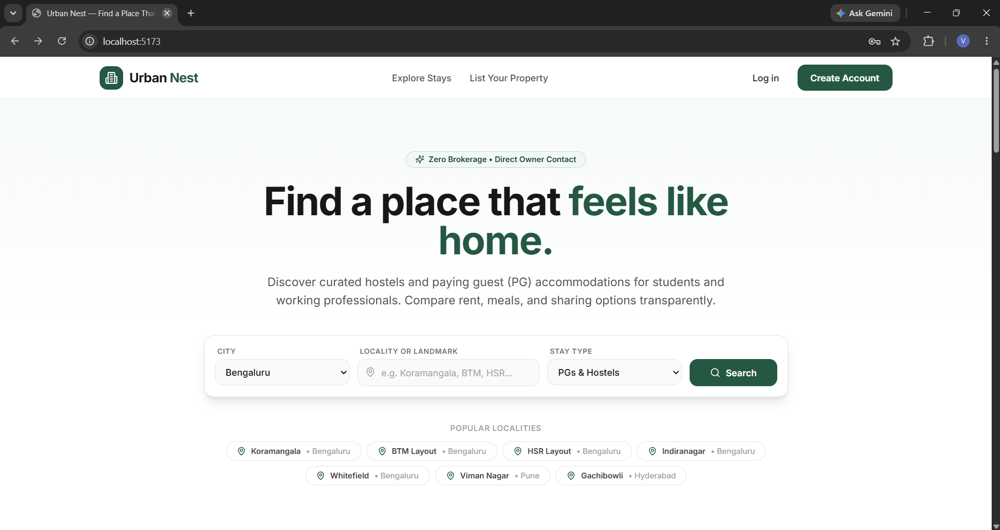
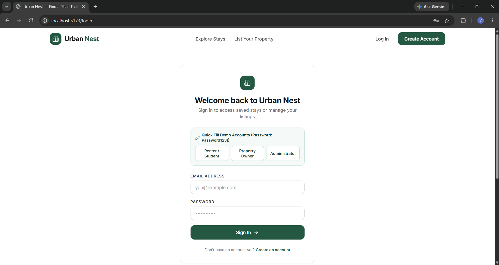
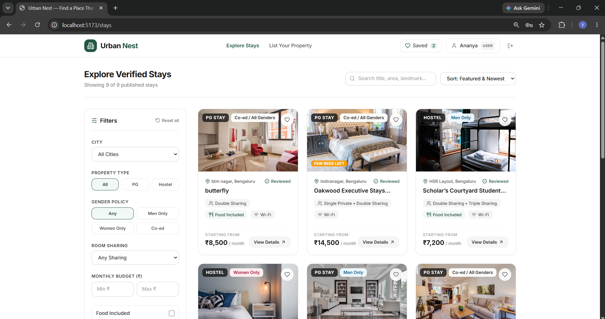
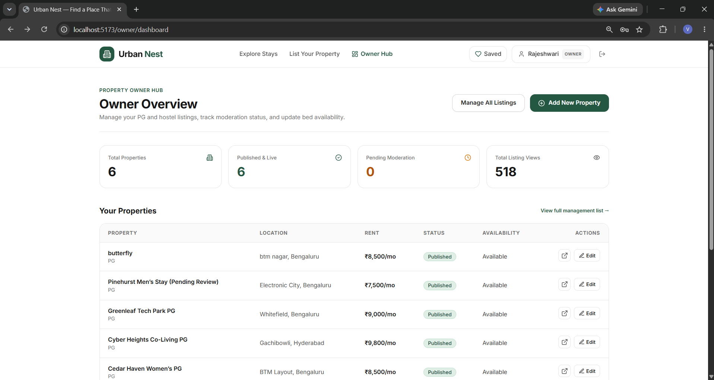

# Urban Nest — Hostel & Paying Guest Discovery Platform

[](https://www.typescriptlang.org/)
[](https://reactjs.org/)
[](https://vitejs.dev/)
[](https://tailwindcss.com/)
[](https://nodejs.org/)
[](https://expressjs.com/)
[](https://www.mongodb.com/)

**Urban Nest** is a full-stack hostel and paying guest (PG) accommodation discovery platform designed for students and working professionals. It enables tenants to search for stays, compare rent breakdowns and facilities, save favourites, and contact property owners directly via WhatsApp, Phone, or Email with zero brokerage fees.

---

## 📸 Application Screenshots

### 1. Home & Hero Discovery
> Clean, minimal forest-green and charcoal design with instant locality search, popular hub chips, and handpicked stays.



---

### 2. Verified Stays, Multi-Facet Filters & Sorting
> Filter by city, locality, monthly rent budget, room sharing configuration, food inclusion, and amenities with real-time updates.



---

### 3. Property Details, Transparent Rent Breakdown & Direct Enquiry
> Complete photo gallery, room-wise sharing breakdown, deposit details, house rules, OpenStreetMap integration, and sticky direct WhatsApp/Phone contact cards.



---

### 4. Owner & Admin Moderation Hub
> Property owners manage room inventory and bed availability with real file drag-and-drop uploads. Administrators review submissions, investigate user reports, and verify accounts.



---

## 🚀 Key Features

- **Zero-Brokerage Direct Contact**: 1-click WhatsApp chat link with pre-filled enquiry, phone dialer, and email links.
- **Real File Drag-and-Drop Uploader**: Drop multiple photos from your computer, set primary cover photos, and reorder images. Supports local static storage and Cloudinary.
- **Interactive Multi-Criteria Search**: Filter by City, Locality, PG vs. Hostel, Sharing Type (Single, Double, Triple, 4+), Gender Policy (Male, Female, Co-ed), Rent Range, and Food Included.
- **Transparent Pricing Breakdown**: Upfront deposit, lock-in period, notice period, and utility inclusion details.
- **Shortlist / Favourites**: Persistent saved stays stored per user account for easy comparison across devices.
- **Role-Based Access Control**:
  - **Guests / Renters**: Search, filter, compare, save favourites, report listings.
  - **Property Owners**: Create and edit accommodation listings, manage bed availability, upload photos.
  - **Administrators**: Moderation queue to approve, feature, reject, or suspend listings, and resolve user reports.
- **Zero-Config Database**: Connects to local MongoDB (`mongodb://127.0.0.1:27017/urban-nest`) with automatic in-memory MongoDB fallback and sample data seeding.

---

## 🛠️ Technology Stack

| Layer | Technologies |
| :--- | :--- |
| **Monorepo** | npm workspaces (`client`, `server`, `shared`) |
| **Frontend** | React 18, Vite, TypeScript, Tailwind CSS, TanStack Query, React Router v6, React Hook Form, Zod, Lucide React |
| **Backend** | Node.js, Express.js, TypeScript, Mongoose, Express Session, Connect Mongo, Helmet, Rate Limit |
| **Database** | MongoDB / MongoDB Memory Server |
| **Testing** | Vitest, Supertest, React Testing Library, JSDOM |

---

## ⚡ Quick Start

### 1. Clone & Install Dependencies
```bash
git clone https://github.com/venkatesh0963/UrbanNest.git
cd UrbanNest
npm install
```

### 2. Run in Development
```bash
npm run dev
```

- **Frontend App**: `http://localhost:5173`
- **Backend API**: `http://localhost:5000/api/v1`
- **API Health Check**: `http://localhost:5000/api/v1/health`

---

## 🔑 Quick-Fill Demo Accounts

Use the one-click demo login buttons on the `/login` page (Password for all: `Password123!`):

| Role | Email | Password |
| :--- | :--- | :--- |
| **Student / Renter** | `student@urbannest.in` | `Password123!` |
| **Property Owner** | `owner@urbannest.in` | `Password123!` |
| **Administrator** | `admin@urbannest.in` | `Password123!` |

---

## 📂 Project Structure

```text
urban-nest/
├── client/                      # React + Vite frontend
│   ├── src/
│   │   ├── api/                 # Typed API client
│   │   ├── components/          # Header, Footer, PropertyCard, Filters, PhotoDropzone
│   │   ├── features/            # Auth, Favourites hooks & state
│   │   ├── pages/               # Home, Search, Details, Login, Owner & Admin Dashboards
│   │   └── routes/              # Route definitions and ProtectedRoute guards
│   ├── index.html
│   └── vite.config.ts
├── server/                      # Node.js + Express backend
│   ├── src/
│   │   ├── config/              # DB connection & environment
│   │   ├── controllers/         # HTTP request controllers
│   │   ├── middleware/          # Auth, role check, validation, error handlers
│   │   ├── models/              # User, Listing, Favourite, Report schemas
│   │   ├── routes/              # Express API routes
│   │   ├── services/            # Business logic & upload handlers
│   │   └── utils/               # Seed data, slug generators, errors
│   └── tests/                   # Vitest & Supertest integration suite
├── shared/                      # Shared types & schemas
│   ├── schemas/                 # Zod validation schemas
│   └── types/                   # Shared DTO interfaces
├── docs/images/                 # Application screenshots
├── package.json                 # Monorepo scripts
└── README.md
```

---

## 🧪 Testing & Production Build

```bash
# Run all automated tests (backend Supertest + frontend Vitest)
npm test

# Build all workspaces for production
npm run build
```

---

## 📄 License

This project is licensed under the MIT License.
